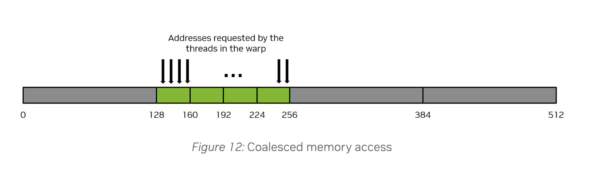
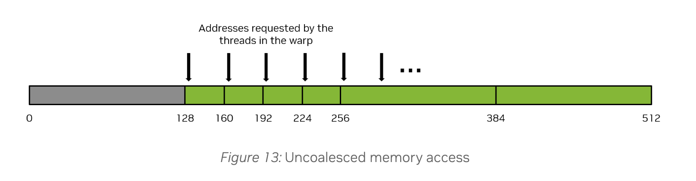
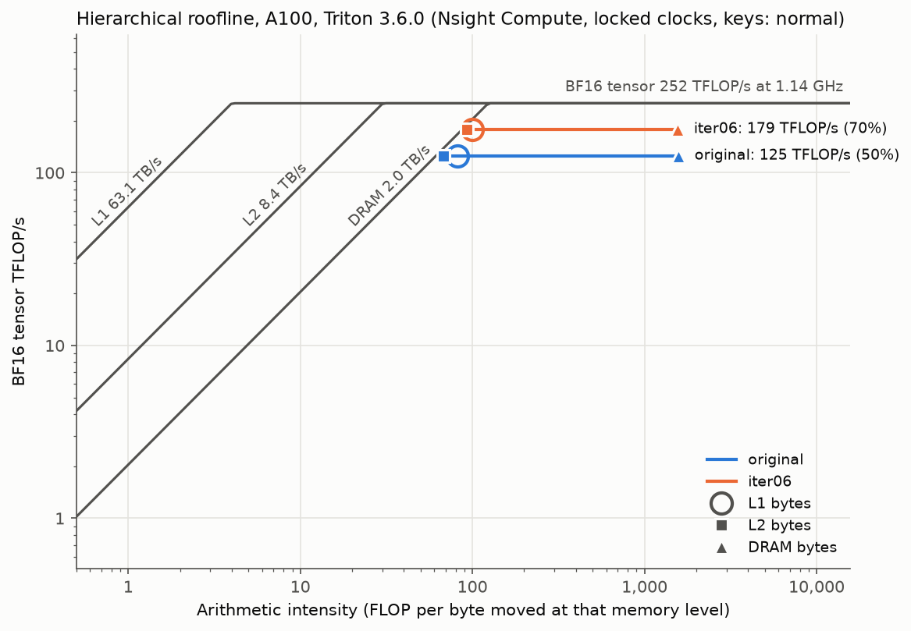
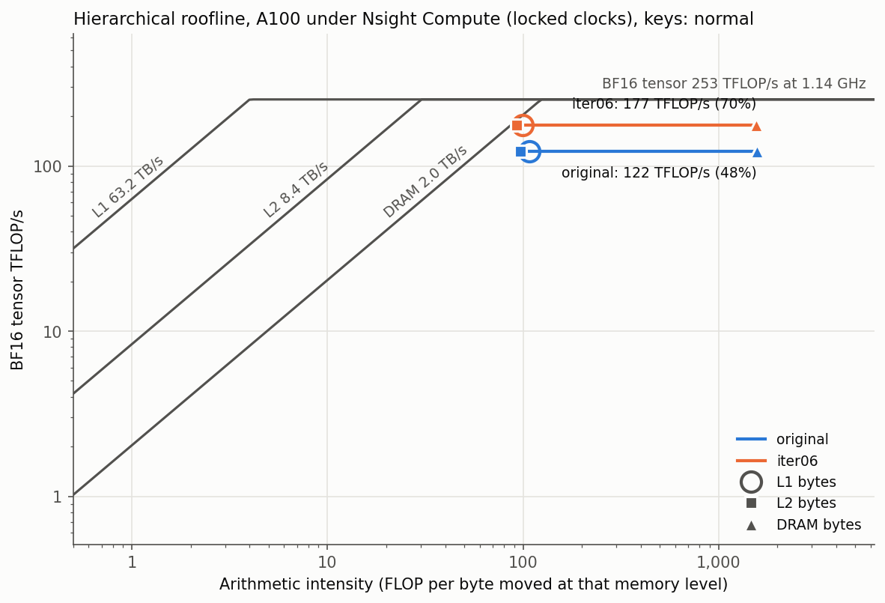

# Analysis: what changed, what the evidence supports

[Back to the overview](README.md)

The agent produced the kernel candidates. I built and examined ablations, compared profiler counters, and inspected the compiled layouts to explain their behavior. This document separates measured results from hypotheses about their causes.

## 1. Workload and measurement

For each key, the kernel computes dot products against all centroids, selects a centroid, and atomically updates that centroid’s sum and count. Each launch uses eight key sets: 32,768 keys per set, dimension 128, and 2,048 unit-length centroids. Inputs are BF16 and sums are FP32.

The evaluation covers 16 Qwen2.5-1.5B layer/head key sets from two prompts. Individual case measurements replicate one key set across all eight batch slots to preserve the launch shape.The harness first evaluates the baseline kernel and sends its results to Claude. Claude proposes a candidate Triton kernel revision, which the harness runs and checks aginst a FP32 reference for correctness, and if it passes, benchmarks against the original. 

Results including errors, timings, and Nsight Compute profiles are fed back to guide the next revision. The loop retains the fastest candidate that passes the checks and, with `--patience 4`, stops after four consecutive iterations without improvement or when the iteration limit is reached.

### Original benchmark, Triton 3.6.0

| Input | Original | iter06 | Speedup |
|---|---:|---:|---:|
| Evaluation A: eight distinct key sets | 0.899 ms | 0.654 ms | 1.374× |
| Evaluation B: eight distinct key sets | 0.905 ms | 0.657 ms | 1.381× |
| Individual key sets, each replicated eight times | 0.889–0.921 ms | 0.655–0.668 ms | 1.36–1.40× |

The median of the 16 individual speedups is **1.38×**. The subsequent 3.8 notebook reports a **1.41× median** across those key sets. Neither figure is an end-to-end model speedup.

## 2. What the variants change

**Plain argmax** reduces each score tile to a 1D score maximum and index inside the centroid loop.

**Deferred, unpacked argmax** keeps separate score and index tiles, updates them elementwise, and reduces once after the loop. It avoids packing induced precision loss. 

**Packed argmax** also defers reduction, but stores the centroid index in the low bits of each FP32 score. A maximum then carries the index with the score. This reduces bookkeeping at the cost of score precision.

**Tile accumulation of keys** uses the already loaded key tile for atomic updates. **Flat reload** reloads keys in flat chunks before accumulation. Constant and runtime column strides both equal 1; the difference is whether the compiler knows that value. The runtime version uses `do_not_specialize=["stride_one"]`.

v1–v5 and v10 use the original tile settings. v6 changes v5’s `BLOCK_K` from 32 to 64 and `EPI_ROWS` from 32 to 16. The separately launched `iter06` can select a different configuration; do not assume it is identical to v6 in every run.

## 3. Triton 3.6 ablations

Sorted from slowest to fastest. “Packed” includes deferred reduction. Occupancy is the achieved profiler metric. All variants issue **1,056,768 atomic requests** in this measurement.

| Variant | Argmax | Accumulation | Stride | Time (µs) | Registers/thread | Occupancy (%) | Warp instructions (M) | Atomic sectors/request |
|---|---|---|---|---:|---:|---:|---:|---:|
| v9 | Packed | Tile | Runtime | 1,536 | 254 | 12.3 | 111.9 | 31.90 |
| v8 | Plain | Tile | Runtime | 1,410 | 168 | 17.8 | 165.0 | 31.90 |
| v1 | Plain | Tile | Constant | 1,117 | 164 | 17.9 | 163.8 | 16.00 |
| Original | Plain | Tile | Constant | 1,099 | 166 | 18.0 | 159.8 | 16.00 |
| v2 | Packed | Tile | Constant | 1,024 | 168 | 17.9 | 110.2 | 16.00 |
| v4 | Packed | Flat reload | Constant | 995 | 128 | 23.6 | 117.2 | 16.00 |
| v3 | Plain | Flat reload | Runtime | 918 | 130 | 18.0 | 173.5 | 4.12 |
| v10 | Deferred, unpacked | Flat reload | Runtime | 865 | 162 | 18.1 | 138.6 | 4.12 |
| v5 | Packed | Flat reload | Runtime | 839 | 130 | 18.0 | 120.4 | 4.12 |
| iter06 | Packed | Flat reload | Runtime | 812 | 238 | 12.1 | 108.8 | 4.12 |
| v6 | Packed | Flat reload | Runtime | 776 | 168 | 18.0 | 115.8 | 4.12 |

### Main Loop: Deferral versus packing

v3 → v10 → v5 holds the epilogue and launch settings fixed:

| Change | Runtime | Time reduction | Warp instructions removed |
|---|---:|---:|---:|
| Defer reduction without packing: v3 → v10 | 918 → 865 µs | 53 µs; 5.8% | 34.9M |
| Add packing: v10 → v5 | 865 → 839 µs | 26 µs; 3.0% | 18.2M |

Along this ablation path, deferring reduction ops outside of the main loop accounts for about two thirds of the combined 79 µs saved and 53.1M instructions removed. These fractions are not a decomposition of the entire original to iter06 speedup.

The combined packing/deferral change removes 31–33% of instructions in the matched pairs v1→v2, v3→v5, and v8→v9. In the displayed run, original→iter06 removes **31.9%** of executed warp instructions. 

For packing With $C$ centroids, packing uses $b=\lceil\log_2 C\rceil$ index bits, leaving $23-b$ FP32 fraction bits. Scores with the same score bits can exchange order.  The score bit width bounds the packing only loss. 

For a nonzero key and unit length centroids, the packing regret bound is:

$$
\frac{s_{\mathrm{best}}-s_{\mathrm{chosen}}}{\lVert k\rVert_2}
\le 2^{-(23-b)},
\qquad b=\lceil\log_2 C\rceil.
$$

This is probably not worth it given the 3% speedup for loss of precision. Nevertheless it was something interesting the agent tried.

### Epilogue and layout

Flat reload with constant stride (v4) still touches 16 sectors/request. Flat reload with runtime stride (v5) reaches 4.12. Runtime stride applied directly to tile accumulation (v8/v9) instead reaches 31.90. The useful result comes from the combination, not from hiding a stride universally.

These comparisons establish effects of the source changes. They do not isolate coalescing as the sole cause of the timing gains: generated instructions, registers, and layouts can change together.

## 4. Why the atomic access pattern matters

For one scalar FP32 atomic instruction, assume 32 active lanes, distinct addresses, and an aligned starting address:

| Layout | Element indices across lanes | Useful bytes | 32-byte sectors touched |
|---|---|---:|---:|
| Four consecutive elements assigned per thread | `0, 4, 8, …, 124` | 128 | 16 |
| Consecutive elements across lanes | `0, 1, 2, …, 31` | 128 | 4 |

The first pattern uses 128 / (16 × 32) = **25%** of the bytes in the touched sectors; the second uses **100%**. Over four scalar instructions, both layouts can update the same 128 elements, but the first revisits the wider sector footprint on each instruction.

A vector load can use several consecutive values per thread in one instruction. A scalar atomic processes one value per thread per instruction. A layout suited to the former can therefore be inefficient for the latter.

For illustration:

**Coalesced access. Loading 128B across 4 sectors.**



**Uncoalesced access. Loading 128B across 16 sectors (128 / (16*32) = 25% memory utilization rate)**


The original 3.6 IR inspection found `sizePerThread = [4]` for the flat constant stride sum atomics versus `[1]` for the runtime stride version. See [saved IR](ir/) for the complete layouts and generated instructions.

```
// v4, constant stride: key loads use #blocked; sum atomics use #blocked4.
#blocked = #ttg.blocked<{sizePerThread = [8], threadsPerWarp = [32], warpsPerCTA = [4], order = [0]}>
#blocked4 = #ttg.blocked<{sizePerThread = [4], threadsPerWarp = [32], warpsPerCTA = [4], order = [0]}>

// v5, runtime stride: key loads and sum atomics use the same layout.
#blocked = #ttg.blocked<{sizePerThread = [1], threadsPerWarp = [32], warpsPerCTA = [4], order = [0]}>
```

## 5. Triton 3.8: coalescing fixed, performance question remains

[Triton PR #10059](https://github.com/triton-lang/triton/pull/10059), included in 3.8, makes atomic coalescing account for narrower atomic instructions. Its FP32 add handling covers A100. The reported 3.8 IR gives the original sum atomic consecutive columns across warp lanes (`sizePerThread = [1, 1]`, `threadsPerWarp = [1, 32]`), instead of the earlier `[1, 4]` per thread layout.

All variants now report approximately **4.12 sectors/request**; the pasted output rounds iter06 to 4.1. Atomic request counts remain 1,056,768.

### Full 3.8 profiler results

| Variant | Time (µs) | Registers/thread | Occupancy (%) | Warp instructions (M) | Atomic sectors/request |
|---|---:|---:|---:|---:|---:|
| v8 | 1,196 | 254 | 12.2 | 148.1 | 4.12 |
| v1 | 1,190 | 254 | 12.2 | 148.1 | 4.12 |
| Original | 1,125 | 254 | 12.2 | 142.9 | 4.12 |
| v9 | 1,059 | 254 | 12.1 | 112.2 | 4.12 |
| v2 | 1,058 | 254 | 12.1 | 112.2 | 4.12 |
| v4 | 1,037 | 208 | 12.3 | 118.7 | 4.12 |
| v3 | 941 | 130 | 18.1 | 156.5 | 4.12 |
| v10 | 857 | 162 | 18.0 | 139.3 | 4.12 |
| v5 | 838 | 130 | 18.0 | 120.3 | 4.12 |
| v6 | 775 | 168 | 18.0 | 115.6 | 4.12 |
| iter06 | 768 | 168 | 18.0 | 115.6 | ≈4.1 |

### Selected cross version comparisons

These use the 3.6 table above, rather than mixing in earlier profiler runs.

| Variant | Time (µs), 3.6 → 3.8 | Registers/thread, 3.6 → 3.8 | Sectors/request, 3.6 → 3.8 |
|---|---:|---:|---:|
| Original | 1,099 → 1,125 | 166 → 254 | 16.00 → 4.12 |
| v4: flat, constant stride | 995 → 1,037 | 128 → 208 | 16.00 → 4.12 |
| v5: flat, runtime stride | 839 → 838 | 130 → 130 | 4.12 → 4.12 |
| v9: packed tile, runtime stride | 1,536 → 1,059 | 254 → 254 | 31.90 → 4.12 |
| v6: adjusted tile settings | 776 → 775 | 168 → 168 | 4.12 → 4.12 |
| iter06 | 812 → 768 | 238 → 168 | 4.12 → ≈4.1 |

**Observed:** the original’s sectors/request fall by about 3.9×, but its runtime does not improve. Registers rise from 166 to 254 and achieved occupancy falls from 18.0% to 12.2%.

**Still unresolved:** whether register pressure, layout conversions, address calculations, scheduling, or other generated code changes explain the remaining cost. Higher register usage and lower occupancy are evidence to investigate next.  More to follow...


## 6. Roofline context
The roofline provides context for why fewer memory transactions do not necessarily make the kernel faster. From Triton 3.6 to 3.8, the original kernel’s L1 and L2 arithmetic intensity increases: it performs the same tensor work with fewer bytes moved at those levels. However, its throughput remains roughly unchanged, at 125 versus 122 TFLOP/s; iter06 likewise stays near 179 versus 177 TFLOP/s.

Both kernels lie in the compute limited region of the roofline model, where peak memory bandwidth does not set the tighter theoretical limit. The plots show improved traffic efficiency without improved throughput, but do not identify the remaining bottleneck.

| Triton 3.6 | Triton 3.8 |
|:---:|:---:|
|  |  |

## 7. Correctness, precision, and limits

For packing an acceptance criterion is a chosen - score gap no greater than `2^-12 × ||key||₂`, relative to the FP32 reference. At 2,048 centroids, the **1.9 × 10⁻⁴**, score gap was in bounds as expected. 

Packing uses `ceil(log2(C))` for index bits. At 2,048 centroids, that is 11 of the FP32 fraction’s 23 bits, leaving 12 score fraction bits. More centroids consume more bits and coarsen score discrimination. The upper bound score gap doubles with C.  

Again ablations have shown that packing only provides a 3% speedup, so it's not really doing a lot here.

## Reproduction and evidence

- [Full notebook](notebooks/kernel_explained.ipynb)
- [Triton 3.8 executed notebook](results/kernel_explained_triton_3.8.ipynb) and [summary](results/triton_3.8.txt)
- [Roofline measurements](results/roofline.txt), [result directory](results/), and [TTGIR/PTX/SASS](ir/)
- [Agent loop](agent/agent_loop.py) and [iter06](iter06.py)
- [Double-P](https://arxiv.org/abs/2602.05191), [Nsight Compute profiling guide](https://docs.nvidia.com/nsight-compute/ProfilingGuide/index.html), and [Triton 3.8 release](https://github.com/triton-lang/triton/releases/tag/v3.8.0)

