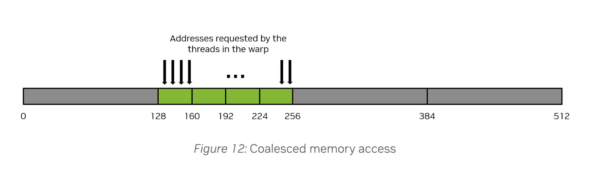
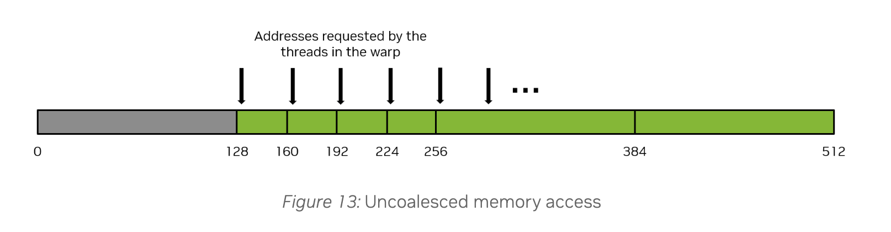

# Evaluating an agent optimized Triton kernel

I created a Claude driven agent loop that optimized Double-P’s [1] Triton k-means assignment kernel, achieving a **1.38× median speedup** on an A100 across 16 real Qwen2.5-1.5B layer KV head key sets (8 per launch). The sixth candidate, **iter06**, passed the specified correctness tolerance at 2,048 centroids.

TLDR Takeaways:
    
1. **Defer reduction ops outside of loops**

2. **Precision can be sacrificed for speed when acceptable**
    
3. **Inspect the thread to address memory access patterns.** For example, a vector load accesses several values per thread. A scalar atomic accesses one.  A layout that beneifts one can be inefficient for the other. 

## Workload and agent measurement

This comparison covers the original and iter06, with ablations to explain the improvement. Measurements and reproduction steps are in [`kernel_explained.ipynb`](notebooks/kernel_explained.ipynb) and [`results/`](results/).  Compiled TTGIR, PTX, and SASS are in [`ir/`](ir/).  As a reminder, these are kernel timings, and have not been tested within the model.

For each key, the kernel selects the centroid with the largest dot product, adds the key to that centroid’s sum, and increments its count. Each launch processes eight independent key sets, each containing 32,768 keys of dimension 128 and 2,048 unit-length centroids. Inputs are BF16 and sums use FP32.

The evaluation uses 16 layer KV head key sets from two text prompts. For individual measurements, each key set is replicated across all eight batch slots, preserving the launch shape. The harness checks candidates against an FP32 reference, benchmarks original and candidate in interleaved rounds within the same process, and repeats correctness checks after timing. The agent receives benchmark results and Nsight Compute reports to guide subsequent revisions.

## Results

| Input | Original | iter06 | Speedup |
|---|---:|---:|---:|
| Evaluation A: eight distinct key sets | 0.899 ms | 0.654 ms | 1.374× |
| Evaluation B: eight distinct key sets | 0.905 ms | 0.657 ms | 1.381× |
| Individual key sets, each replicated eight times | 0.889–0.921 ms | 0.655–0.668 ms | 1.36–1.40× |

The median of the 16 individual case speedups is **1.38×**. For every key, the chosen score must be within $2^{-12}\lVert k\rVert_2$ of the ground truth best centroid. At 2,048 centroids, iter06 passes both evaluation sets, with a worst measured cosine-score gap of **$1.9\times10^{-4}$**, below the $2.44\times10^{-4}$ tolerance.  The reasons and necessity for a tolerance is explained below.

## Two kernel changes

**Packed argmax with a deferred reduction.** The original reduces each score tile to a maximum and index inside the centroid loop. iter06 replaces low score bits with the centroid index, maintains elementwise maxima across iterations, and performs one reduction after the loop. This reduces repeated reduction work at the cost of score precision.  It reduces the overall warp instructions as seen on Nsight compute by 31-33%.  Note that idx packing is necessary for this optimization since we are incrementing `BLOCK_K` at a time and the centroid idx is relative to that.
```python
# Inside the centroid loop:
bits = ip.to(tl.int32, bitcast=True)
packed = ((bits & MASK_HI) | idx[None, :]).to(tl.float32, bitcast=True)
best = tl.maximum(best, packed)

# After the loop:
row_best = tl.max(best, axis=1)
max_idx = row_best.to(tl.int32, bitcast=True) & MASK_LO
```

With $C$ centroids, packing uses $b=\lceil\log_2 C\rceil$ index bits, leaving $23-b$ FP32 fraction bits. Scores with the same score bits can exchange order.  The score bit width bounds the packing only loss.

For a nonzero key and unit-length centroids, the idealized packing-only regret bound is:

$$
\frac{s_{\mathrm{best}}-s_{\mathrm{chosen}}}{\lVert k\rVert_2}
\le 2^{-(23-b)},
\qquad b=\lceil\log_2 C\rceil.
$$


**Flat reload epilogue.** After storing assignments, iter06 reloads keys in flat chunks before atomic accumulation. The kernel uses `@triton.jit(do_not_specialize=["stride_one"])`, and the caller passes `stride_one=1`. In this flat epilogue, preventing specialization to 1 changes the compiled layout: neighboring lanes update consecutive columns instead of every fourth column. The excerpt below runs after labels are stored and the block synchronizes; base pointers select the current batch item.

```python
ii = tl.arange(0, EPI_ROWS * D)
r_loc = ii // D
cc = (ii % D) * stride_one
k_base = K + b * N * D
s_base = S + b * C * D

for r0 in range(0, BLOCK_N, EPI_ROWS):
    rr = start_n + r0 + r_loc
    rmask = rr < N
    lab = tl.load(m_base + rr, mask=rmask, other=0)
    kv = tl.load(k_base + rr * D + cc, mask=rmask, other=0.0)
    tl.atomic_add(
        s_base + lab * D + cc, kv.to(tl.float32),
        mask=rmask, sem="relaxed",
    )
```

## What the ablations establish

The following Nsight Compute measurements use one key set and locked clocks. They are separate from the benchmark timings above. All variants pass the specified checks at 2,048 centroids. **Constant** and **runtime** strides both equal 1 and only whether or not the compiler knows that value differs. “Packed” includes deferred reduction and “tile” refers to 2D tile accumulation from the tile that is already loaded.  "Flat reload" refers to reloading in 1D.

| Variant | Argmax | Accumulation | Column stride | Time (µs) | Atomic sectors/request |
|---|---|---|---|---:|---:|
| Original | Plain | Tile | Constant | 1,105 | 16.03 |
| v1: rewritten baseline | Plain | Tile | Constant | 1,107 | 16.03 |
| v2 | Packed | Tile | Constant | 1,026 | 16.03 |
| v3 | Plain | Flat reload | Runtime | 908 | 4.12 |
| v4 | Packed | Flat reload | Constant | 998 | 16.03 |
| v5 | Packed | Flat reload | Runtime | 838 | 4.12 |
| v8 | Plain | Tile | Runtime | 1,417 | 31.90 |
| v9 | Packed | Tile | Runtime | 1,548 | 31.90 |
| v6: matched tile settings | Packed | Flat reload | Runtime | 768 | 4.12 |
| iter06 | Packed | Flat reload | Runtime | 776 | 4.12 |

**Packing reduces instructions.** Matched comparisons show 31–33% fewer executed warp instructions, with unchanged sectors/request. Overall, iter06 executes 115.8M versus the original’s 159.8M instructions: **27.6% fewer**.

**Flat reload and runtime stride work together here.** Flattening alone leaves sectors/request at 16.03. Runtime stride on the tile epilogue increases them to 31.90. Their combination reaches 4.12. Every variant issues 1,056,768 atomic requests, so the improvement is in how those requests access memory.

**Tile settings close the remaining gap.** v6 changes v5’s `BLOCK_K` from 32 to 64 and `EPI_ROWS` from 32 to 16, reproducing iter06’s SASS after normalizing kernel names.

## Reading the thread mapping beneath Triton

While Triton abstracts away much of the low level memory access patterns, understanding how each thread (Nvidia also calls these warp lanes) maps to memory can be useful for optimizing memory performance.  A warp consists of 32 threads that each execute an instruction in lock step. As far as memory is concerned, Nvidia defines a sector as an aligned 32 byte-chunk of memory inside a cache-line or device memory([Nsight Compute profiling guide](https://docs.nvidia.com/nsight-compute/ProfilingGuide/index.html)). To get good memory performance, we want the warps coalesced memory access to result in as little memory transactions as possible.  A memory transaction is defined as a 32 byte sector load.  Loading a value loads a 32 byte sector.

**Perfectly coalesced access. Loading 128 bytes across 4 x 32-byte sectors.**



**Really badly coalesced access. Loading 128 bytes across 16 x 32-byte sectors (128 / (16*32) = 0.25 memory utilization rate)**



### Match the layout to the instruction

Giving each thread four consecutive FP32 values can enable a **16-byte vector load**: lane 0 loads `0–3`, lane 1 loads `4–7`, and so on. Together, the threads access contiguous data in one instruction.  This is the normal use case.

If those loads instead execute as **four scalar instructions** like in scalar atomics, the first accesses `0,4,8,…`, the second `1,5,9,…`. Each instruction spreads addresses across more sectors. Left side memory utilization is 25%. Right side is 100%. Sectors per request dropped 4x for the same amount of requests.

| Instruction | `sizePerThread = [4]`: lanes 0, 1, 2 … 31 | `sizePerThread = [1]`: lanes 0, 1, 2 … 31 |
|---|---|---|
| First | 0, 4, 8 … 124 | 0, 1, 2 … 31 |
| Second | 1, 5, 9 … 125 | 32, 33, 34 … 63 |
| Third | 2, 6, 10 … 126 | 64, 65, 66 … 95 |
| Fourth | 3, 7, 11 … 127 | 96, 97, 98 … 127 |

Ablating the implementations to see the relationship between code and memory performance.

| Implementation | Lane 0 | Lane 1 | Lane 2 | Sectors/request | Sector use |
|---|---|---|---|---|---:|
| Original tile; flat reload, constant stride | `s[b, c, 0]` | `s[b, c, 4]` | `s[b, c, 8]` | 16.03 | 25% |
| Flat reload, runtime stride | `s[b, c, 0]` | `s[b, c, 1]` | `s[b, c, 2]` | 4.12 | 100% |
| Tile, runtime stride | `s[b, c0, 0]` | `s[b, c1, 0]` | `s[b, c0, 0]` | 31.90 | 12.9% |

TTGIR shows the two layouts:

```
// v4, constant stride: key loads use #blocked; sum atomics use #blocked4.
#blocked = #ttg.blocked<{sizePerThread = [8], threadsPerWarp = [32], warpsPerCTA = [4], order = [0]}>
#blocked4 = #ttg.blocked<{sizePerThread = [4], threadsPerWarp = [32], warpsPerCTA = [4], order = [0]}>

// v5, runtime stride: key loads and sum atomics use the same layout.
#blocked = #ttg.blocked<{sizePerThread = [1], threadsPerWarp = [32], warpsPerCTA = [4], order = [0]}>
```

The rule that if a thread requests a 4-byte word, the actual memory transaction the warp will generate to global memory will be 32 bytes in total applies everywhere. Whether several elements per thread hurts depends on how many instructions those elements take.  
- This optimization applies to scalar memory instructions i.e instructions that compile to one instruction per element, as opposed to one instruction per many elements.

## Recap of what the agent did, and how we as humans can apply these insights

1. **Reduce instruction count.**
   - Defered reductions until after the loop.
   - Packed scores and indices together.  Given the acceptable precision bound, it was able to use this technique effectively.

2. **Match memory layouts to generated instructions.**
   - Look for row scatter-adds such as `dest[idx[i], :] += src[i, :]`.
   - **Measure:** 32 threads accessing four distinct FP32 values can fit into four aligned sectors per instruction. The original averaged 16.03 sectors/request.
   - **Inspect:** read the atomic’s TTGIR layout and check PTX/SASS. Map the addresses accessed across lanes in one instruction; a layout suited to vector loads can be inefficient for scalar atomics.
   - **Experiment:** flat reload with runtime stride produced consecutive accesses across lanes. Runtime stride on the 2D tile instead spread lanes across keys and worsened performance. Neither change alone was sufficient here.
   - **Verify:** check correctness, compiled layouts, sectors/request, and kernel time. Fewer sectors are useful only if the overall kernel benefits.

## Limits
Results cover one A100, one benchmark shape, and one model’s keys. Packing trades score precision for centroid index bits: its regret bound doubles whenever the centroid count doubles. Tests at 4,096 and 8,192 centroids observed errors exceeding the fixed $2⁻¹²$ tolerance, consistent with that tradeoff. Whether the larger $C$ meaningfully affect downstream model quality has not been evaluated.

Source: [1]: [Double-P](https://arxiv.org/abs/2602.05191). Terminology: [Nsight Compute profiling guide](https://docs.nvidia.com/nsight-compute/ProfilingGuide/index.html).


