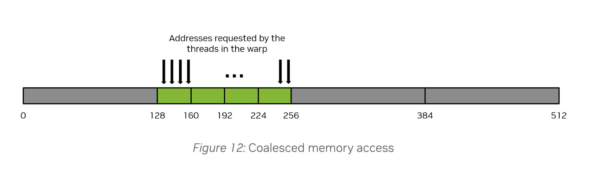
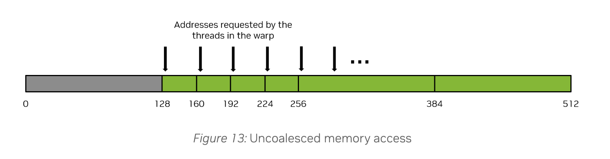

# Evaluating an agent optimized Triton kernel

I created a Claude driven agent loop that optimized Double-P’s [1] Triton k-means assignment kernel, achieving a **1.38× median speedup** on an A100 across 16 real Qwen2.5-1.5B layer KV head key sets (8 per launch). The sixth candidate, **iter06**, passed the specified correctness tolerance at 2,048 centroids.

TLDR Takeaways:
    
1. **Defer reduction ops outside of loops**

2. **Precision can be sacrificed for speed when acceptable**
    
3. **Inspect the thread to address memory access patterns.** For example, a vector load accesses several values per thread. A scalar atomic accesses one.  A layout that beneifts one can be inefficient for the other. 

## Workload and agent measurement

This comparison covers the original and iter06, with ablations to explain the improvement. Measurements and reproduction steps are in [`kernel_explained.ipynb`](notebooks/kernel_explained.ipynb) and [`results/`](results/).  Compiled TTGIR, PTX, and SASS are in [`Triton_3.6_ir/ir/`](Triton_3.6_ir/ir/) (Triton 3.8.0: [`Triton_3.8_ir/`](Triton_3.8_ir/)).  As a reminder, these are kernel timings, and have not been tested within the model.

For each key, the kernel selects the centroid with the largest dot product, adds the key to that centroid’s sum, and increments its count. Each launch processes eight independent key sets, each containing 32,768 keys of dimension 128 and 2,048 unit-length centroids. Inputs are BF16 and sums use FP32.

The evaluation uses 16 layer KV head key sets from two text prompts. For individual measurements, each key set is replicated across all eight batch slots, preserving the launch shape. The harness checks candidates against an FP32 reference, benchmarks original and candidate in interleaved rounds within the same process, and repeats correctness checks after timing. The agent receives benchmark results and Nsight Compute reports to guide subsequent revisions.

## Results

| Input | Original | iter06 | Speedup |
|---|---:|---:|---:|
| Evaluation A: eight distinct key sets | 0.899 ms | 0.654 ms | 1.374× |
| Evaluation B: eight distinct key sets | 0.905 ms | 0.657 ms | 1.381× |
| Individual key sets, each replicated eight times | 0.889–0.921 ms | 0.655–0.668 ms | 1.36–1.40× |

The median of the 16 individual case speedups is **1.38×**. For every key, the chosen score must be within $2^{-12}\lVert k\rVert_2$ of the ground truth best centroid. At 2,048 centroids, iter06 passes both evaluation sets, with a worst measured cosine-score gap of **$1.9\times10^{-4}$**, below the $2.44\times10^{-4}$ tolerance.  The reasons and necessity for a tolerance is explained below.

## Two kernel changes

**Packed argmax with a deferred reduction.** The original reduces each score tile to a maximum and index inside the centroid loop. iter06 replaces low score bits with the centroid index, maintains elementwise maxima across iterations, and performs one reduction after the loop. This reduces repeated reduction work at the cost of score precision.  It reduces the overall warp instructions as seen on Nsight compute by 31-33%.  Packing is not strictly necessary. Ablation v10 below carries a score tile and an index tile of size [BLOCK_N, BLOCK_K], updates both elementwise, and reduces once after the loop. It keeps scores exact and gets about two-thirds of the instruction reduction; packing adds the rest.

```python
# Inside the centroid loop:
bits = ip.to(tl.int32, bitcast=True)
packed = ((bits & MASK_HI) | idx[None, :]).to(tl.float32, bitcast=True)
best = tl.maximum(best, packed)

# After the loop:
row_best = tl.max(best, axis=1)
max_idx = row_best.to(tl.int32, bitcast=True) & MASK_LO
```

With $C$ centroids, packing uses $b=\lceil\log_2 C\rceil$ index bits, leaving $23-b$ FP32 fraction bits. Scores with the same score bits can exchange order.  The score bit width bounds the packing only loss.

For a nonzero key and unit-length centroids, the idealized packing-only regret bound is:

$$
\frac{s_{\mathrm{best}}-s_{\mathrm{chosen}}}{\lVert k\rVert_2}
\le 2^{-(23-b)},
\qquad b=\lceil\log_2 C\rceil.
$$


**Flat reload epilogue.** After storing assignments, iter06 reloads keys in flat chunks before atomic accumulation. The kernel uses `@triton.jit(do_not_specialize=["stride_one"])`, and the caller passes `stride_one=1`. In this flat epilogue, preventing specialization to 1 changes the compiled layout: neighboring lanes update consecutive columns instead of every fourth column. The excerpt below runs after labels are stored and the block synchronizes; base pointers select the current batch item.

```python
ii = tl.arange(0, EPI_ROWS * D)
r_loc = ii // D
cc = (ii % D) * stride_one
k_base = K + b * N * D
s_base = S + b * C * D

for r0 in range(0, BLOCK_N, EPI_ROWS):
    rr = start_n + r0 + r_loc
    rmask = rr < N
    lab = tl.load(m_base + rr, mask=rmask, other=0)
    kv = tl.load(k_base + rr * D + cc, mask=rmask, other=0.0)
    tl.atomic_add(
        s_base + lab * D + cc, kv.to(tl.float32),
        mask=rmask, sem="relaxed",
    )
```

## Where the kernels sit against the A100’s limits


Nsight Compute counters, one launch per kernel, locked clocks, one key set. Both kernels do the same 137.4 GFLOP of BF16 tensor math (executed `HMMA.16816.F32.BF16` instructions × 4,096, matching 2·B·N·C·D) and read about 88 MB from DRAM. Each point plots achieved FLOP/s against FLOPs per byte moved at one memory level. Nsight locks the SM clock at 1.14 GHz, so the BF16 tensor ceiling is 252 TFLOP/s rather than 312 at boost clock.

Each row below is how long a kernel would take if that one resource ran at its peak rate and nothing else limited it. The resources work concurrently, so these times overlap and don’t add up; the largest is a lower bound on the runtime.

| Resource at peak rate | Original (µs) | iter06 (µs) |
|---|---:|---:|
| BF16 tensor math | 544 | 540 |
| L2 traffic | 242 | 177 |
| DRAM traffic | 43 | 43 |
| L1 traffic | 27 | 22 |
| **Measured** | **1,097** | **770** |

Tensor math sets the lower bound for both kernels, at about 540 µs. iter06 reaches 70% of the tensor ceiling and the original 50%. No memory level is close to its ceiling. The roofline shows how far each kernel is from the hardware limit, not why; the ablations below attribute iter06’s gain to its changes. Counters and method: [`results/roofline.txt`](results/roofline.txt).

## What the ablations establish

The following Nsight Compute measurements use one key set and locked clocks. They are separate from the benchmark timings above. All variants pass the specified checks at 2,048 centroids. **Constant** and **runtime** strides both equal 1 and only whether or not the compiler knows that value differs. “Packed” includes deferred reduction and “tile” refers to 2D tile accumulation from the tile that is already loaded.  "Flat reload" refers to reloading in 1D. **Atomic sectors/request** is an average over the kernel’s atomic instructions: the 32-byte sectors they touched divided by the number of requests, where one request is one atomic instruction executed by a warp. For 32 lanes adding 4-byte values the minimum is 4; the 4 count atomics among each block’s 516 atomic requests account for the extra 0.12.


| Variant | Argmax | Accumulation | Column stride | Time (µs) | Reg/thread | Occupancy (%) | Warp instructions (M) | Atomic sectors/request |
|---|---|---|---|---:|---:|---:|---:|---:|
| v9 | Packed | Tile | Runtime | 1,536 | 254 | 12.3 | 111.9 | 31.90 |
| v8 | Plain | Tile | Runtime | 1,410 | 168 | 17.8 | 165.0 | 31.90 |
| v1: rewritten baseline | Plain | Tile | Constant | 1,117 | 164 | 17.9 | 163.8 | 16.00 |
| Original | Plain | Tile | Constant | 1,099 | 166 | 18.0 | 159.8 | 16.00 |
| v2 | Packed | Tile | Constant | 1,024 | 168 | 17.9 | 110.2 | 16.00 |
| v4 | Packed | Flat reload | Constant | 995 | 128 | 23.6 | 117.2 | 16.00 |
| v3 | Plain | Flat reload | Runtime | 918 | 130 | 18.0 | 173.5 | 4.12 |
| v10 | Deferred, unpacked | Flat reload | Runtime | 865 | 162 | 18.1 | 138.6 | 4.12 |
| v5 | Packed | Flat reload | Runtime | 839 | 130 | 18.0 | 120.4 | 4.12 |
| iter06 | Packed | Flat reload | Runtime | 812 | 238 | 12.1 | 108.8 | 4.12 |
| v6: adjusted tile settings | Packed | Flat reload | Runtime | 776 | 168 | 18.0 | 115.8 | 4.12 |

v10 was measured in a later run, in which v3 and v5 took 918 and 839 µs; their instruction and sector counts were identical across the two runs.

**Packing reduces instructions.** Matched comparisons (v1→v2, v3→v5, v8→v9) show 31–33% fewer executed warp instructions, with unchanged sectors/request. Overall, iter06 executes 115.8M versus the original’s 159.8M instructions: **27.6% fewer**.

**Deferring the reduction does most of it.** v10 defers the reduction without packing, so no score bits are lost (worst cosine gap 0). Against v3 and v5, which share its epilogue and launch settings, deferral alone removes 34.9M of the 53.1M instructions (66%), and packing the remaining 18.2M. In same-process timing on one key set, v3, v10 and v5 ran 1.151×, 1.225× and 1.249× faster than the original. v10 uses 162 registers to v5’s 130, but on an A100 any count from 129 to 168 fits three 128-thread blocks per SM, so occupancy stayed at 18%.

**Flat reload and runtime stride work together here.** Flattening alone leaves sectors/request at 16.03. Runtime stride on the tile epilogue increases them to 31.90. Their combination reaches 4.12. Every variant issues 1,056,768 atomic requests, so the improvement is in how those requests access memory.

**Tile settings close the remaining gap.** v6 changes v5’s `BLOCK_K` from 32 to 64 and `EPI_ROWS` from 32 to 16, reproducing iter06’s SASS after normalizing kernel names.

## Reading the thread mapping beneath Triton

While Triton abstracts away much of the low level memory access patterns, understanding how each thread (Nvidia also calls these warp lanes) maps to memory can be useful for optimizing memory performance.  A warp consists of 32 threads that each execute an instruction in lock step. As far as memory is concerned, Nvidia defines a sector as an aligned 32 byte-chunk of memory inside a cache-line or device memory([Nsight Compute profiling guide](https://docs.nvidia.com/nsight-compute/ProfilingGuide/index.html)). To get good memory performance, we want the warps coalesced memory access to result in as little memory transactions as possible.  A memory transaction is defined as a 32 byte sector load.  Remember, fetching a single value loads a 32 byte sector from memory.

**Coalesced access. Loading 128B across 4 sectors.**



**Uncoalesced access. Loading 128B across 16 sectors (128 / (16*32) = 25% memory utilization rate)**



### Match the layout to the instruction

Giving each thread four consecutive FP32 values can enable a **16-byte vector load**: lane 0 loads `0–3`, lane 1 loads `4–7`, and so on. Together, the threads access contiguous data in one instruction.  This is the normal use case.

If those loads instead execute as **four scalar instructions** like in scalar atomics, the first accesses `0,4,8,…`, the second `1,5,9,…`. Each instruction spreads addresses across more sectors. Left side memory utilization is 25%. Right side is 100%. Sectors per request dropped 4x for the same amount of requests.

| Instruction | `sizePerThread = [4]`: lanes 0, 1, 2 … 31 | `sizePerThread = [1]`: lanes 0, 1, 2 … 31 |
|---|---|---|
| First | 0, 4, 8 … 124 | 0, 1, 2 … 31 |
| Second | 1, 5, 9 … 125 | 32, 33, 34 … 63 |
| Third | 2, 6, 10 … 126 | 64, 65, 66 … 95 |
| Fourth | 3, 7, 11 … 127 | 96, 97, 98 … 127 |

Ablating the implementations to see the relationship between code and memory performance.

| Implementation | Lane 0 | Lane 1 | Lane 2 | Sectors/request | Sector use |
|---|---|---|---|---|---:|
| Original tile; flat reload, constant stride | `s[b, c, 0]` | `s[b, c, 4]` | `s[b, c, 8]` | 16.03 | 25% |
| Flat reload, runtime stride | `s[b, c, 0]` | `s[b, c, 1]` | `s[b, c, 2]` | 4.12 | 100% |
| Tile, runtime stride | `s[b, c0, 0]` | `s[b, c1, 0]` | `s[b, c0, 0]` | 31.90 | 12.9% |

TTGIR shows the two layouts:

```
// v4, constant stride: key loads use #blocked; sum atomics use #blocked4.
#blocked = #ttg.blocked<{sizePerThread = [8], threadsPerWarp = [32], warpsPerCTA = [4], order = [0]}>
#blocked4 = #ttg.blocked<{sizePerThread = [4], threadsPerWarp = [32], warpsPerCTA = [4], order = [0]}>

// v5, runtime stride: key loads and sum atomics use the same layout.
#blocked = #ttg.blocked<{sizePerThread = [1], threadsPerWarp = [32], warpsPerCTA = [4], order = [0]}>
```

The rule that if a thread requests a 4-byte word, the actual memory transaction the warp will generate to global memory will be 32 bytes in total applies everywhere. Whether several elements per thread hurts depends on how many instructions those elements take.  
- This optimization applies to scalar memory instructions i.e instructions that compile to one instruction per element, as opposed to one instruction per many elements.

## Triton 3.8 now coalesces these atomics

Everything above uses Triton 3.6.0, the version Colab ships. [Triton 3.8.0](https://github.com/triton-lang/triton/releases/tag/v3.8.0) includes [PR #10059](https://github.com/triton-lang/triton/pull/10059), which caps atomic layouts at one element per thread when the hardware has no vector form of the atomic. For FP32 adds, that covers every GPU before Hopper (compute capability below 9.0). I reran the whole notebook on 3.8.0: [`results/kernel_explained_triton_3.8.ipynb`](results/kernel_explained_triton_3.8.ipynb), summarized in [`results/triton_3.8.txt`](results/triton_3.8.txt).

The original’s sum atomic now gets the layout the agent reached by hand: one element per thread, with the 32 lanes on consecutive columns (TTGIR `sizePerThread = [1, 1]`, `threadsPerWarp = [1, 32]`, where 3.6.0 had `sizePerThread = [1, 4]`). Every variant now measures 4.12 sectors/request. Nsight Compute, locked clocks, one key set:

| Variant | Accumulation | Column stride | Sectors/request, 3.6.0 → 3.8.0 | Registers, 3.6.0 → 3.8.0 | Time (µs), 3.6.0 → 3.8.0 |
|---|---|---|---:|---:|---:|
| Original | Tile | Constant | 16.03 → 4.12 | 166 → 254 | 1,105 → 1,125 |
| v1 | Tile | Constant | 16.03 → 4.12 | 164 → 254 | 1,107 → 1,190 |
| v2 | Tile | Constant | 16.03 → 4.12 | 168 → 254 | 1,026 → 1,058 |
| v4 | Flat reload | Constant | 16.03 → 4.12 | 128 → 208 | 998 → 1,037 |
| v8 | Tile | Runtime | 31.90 → 4.12 | 168 → 254 | 1,417 → 1,196 |
| v9 | Tile | Runtime | 31.90 → 4.12 | 254 → 254 | 1,548 → 1,059 |
| v3 | Flat reload | Runtime | 4.12 → 4.12 | 130 → 130 | 908 → 941 |
| v5 | Flat reload | Runtime | 4.12 → 4.12 | 130 → 130 | 838 → 838 |
| iter06 | Flat reload | Runtime | 4.12 → 4.12 | 168 → 168 | 776 → 768 |

**The sectors are fixed, but the original isn’t faster.** On 3.8.0 the original uses 254 registers instead of 166, so two 128-thread blocks fit per SM instead of three (Nsight: 2 blocks allowed by registers; achieved occupancy 12.2%, down from 18%). It takes 1,125 µs against 1,105 µs on 3.6.0, and in same-process timing iter06’s lead grew from 1.38× to 1.41× (median of the 16 key sets). Every variant whose atomic layout changed gained registers or was already at the maximum, and none whose layout stayed the same did. Why the new layout needs more registers isn’t measured. One visible difference is that each thread now covers all 128 key rows of the tile instead of 32 (`warpsPerCTA` went from `[4, 1]` to `[1, 4]`), and each row adds to a different centroid’s address.

**Coalescing still pays when nothing else changes.** v9 has 254 registers on both versions: its sectors fell from 31.90 to 4.12 and its time from 1,548 to 1,059 µs. The original’s roofline shows the traffic saving too. On 3.8.0 it moves 403 MB less through L1 (1,684 → 1,281 MB), which is 16.03 − 4.12 sectors on each of its 1,056,768 atomic requests, yet it reaches 48% of the tensor ceiling instead of 50%. This is why the Verify step below checks time, not just sectors.

Comparing times across the two runs: Nsight locks clocks, and kernels the fix doesn’t touch (v5, iter06) moved by 1% or less. 3.8.0 changes other code too: v3’s executed instructions fell from 173.5M to 156.5M while its time rose 3.6%, so the original’s time change mixes the atomic fix with those changes.

## Recap of what the agent did, and how we as humans can apply these insights

1. **Reduce instruction count.**
   - Defered reductions until after the loop.
   - Packed scores and indices together.  Given the acceptable precision bound, it was able to use this technique effectively.

2. **Match memory layouts to generated instructions.**
   - Identify the kind of instruction pattern. For instance atomic scatter adds ... `dest[idx[i], :] += src[i, :]`.
   - **Measure:** 32 threads, four distinct FP32 values per thread, one value per instruction, then 32 * 4 = 128 bytes, then 128 bytes / 32 bytes a sector = 4 sectors.  We should be able to fit each instruction into 4 aligned sectors.
   - **Inspect:** Nsight Compute to find 16.03 sectors/request. Something is wrong. Read the atomic’s TTGIR layout and check PTX/SASS. Map the addresses accessed across lanes in one instruction. A layout suited to vector loads can be inefficient for scalar atomics and vice versa.
   - **Experiment:** flat reload with runtime stride produced consecutive accesses across lanes. Runtime stride on the 2D tile instead spread lanes across keys and worsened performance. Neither change alone was sufficient here.
   - **Verify:** check correctness, compiled layouts, sectors/request, and kernel time. Fewer sectors are useful only if the overall kernel benefits.

## Conclusion
This took a few days to get to the bottom of.  Maybe bc i'm new to this and I'm not sure agents are the best entities to learn from either. It could be why mathematics professors are currently pissed.  However, on the bright side it did help me understand the intricacies of memory layouts and instruction patterns and what is going on underneath Triton so that is the big plus.

## Limits
Results cover one A100, one benchmark shape, and one model’s keys, compiled with Triton 3.6.0 except the Triton 3.8 section. Packing trades score precision for centroid index bits: its regret bound doubles whenever the centroid count doubles. Tests at 4,096 and 8,192 centroids observed errors exceeding the fixed $2^{-12}$ tolerance, consistent with that tradeoff. Whether a larger $C$ meaningfully affect downstream model quality has not been evaluated.

Source: [1]: [Double-P](https://arxiv.org/abs/2602.05191). Terminology: [Nsight Compute profiling guide](https://docs.nvidia.com/nsight-compute/ProfilingGuide/index.html).


